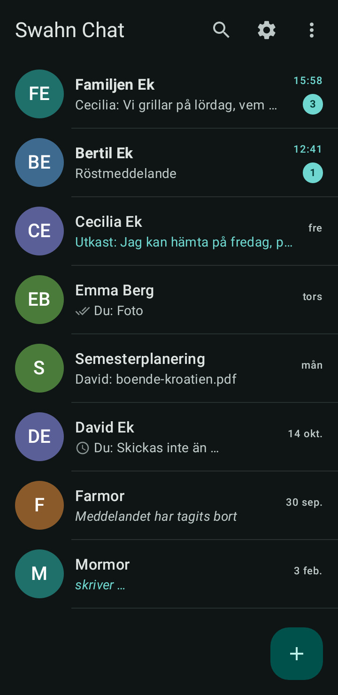
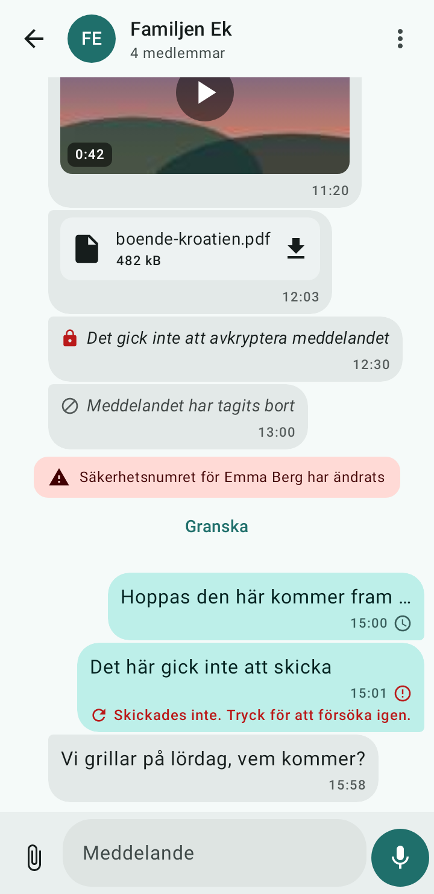

<h1 align="center">Swahn Chat</h1>

<p align="center">
  <strong>A private messenger for the people you trust.</strong><br>
  Self-hosted, end-to-end encrypted and built for a family – not for advertisers.
</p>

<p align="center">
  <a href="https://github.com/felixarvid2/swahn-chatt/releases/latest"></a>
  
  
</p>

Swahn Chat is a private messenger for a family or other small group (about 5–15 people). The server runs on a Raspberry Pi and the app runs on Android. Messages, edits and attachments are encrypted on the phones, so the server only stores accounts, public keys, metadata and ciphertext – never the content itself.

The project was formerly called FamilyChat and was renamed to Swahn Chat in v0.5.0.

| Conversations | Group chat |
|---|---|
|  |  |

## What you get

- One-to-one and group conversations, with edits and message info.
- Encrypted attachments, including photos, audio and files.
- Search, pins, mute and archive.
- Safety numbers and a QR code for verifying contacts.
- Offline delivery: messages are queued per device and survive restarts.
- Push notifications that only say "sync now" – never the message content.
- Invitation-only accounts, with no open signup.
- Backups, restore scripts and a documented server setup.

## Download

Install the latest APK from [Releases](https://github.com/felixarvid2/swahn-chatt/releases/latest). You will need your family's server address and an invitation code from the administrator.

> **Status:** feature complete, but not yet production-tested on a real phone or Raspberry Pi. Every automated test passes, and [HANDOVER.md](HANDOVER.md) lists exactly what has been verified and what has not.

## Run your own server

<details>
<summary>Raspberry Pi with Docker</summary>

The recommended setup is a Raspberry Pi running 64-bit Raspberry Pi OS. The full guide covers backups, upgrades, HTTPS and push notifications: [docs/RASPBERRY_PI_SETUP.md](docs/RASPBERRY_PI_SETUP.md).

```bash
cd deployment
cp .env.example .env        # set SWAHNCHAT_SECRET_KEY to a long random value
docker compose up -d --build
docker compose exec backend python -m app.cli create-invite --admin
```

Reach the server through Tailscale or Caddy. Do not expose port 8000 directly.

</details>

## Privacy in plain words

- **Keys stay on the phones.** Each device has its own Signal-protocol keys.
- **The server stores ciphertext.** It can route messages, but it cannot read them.
- **Pushes carry no content.** A notification only tells the app to fetch new messages.
- **No open signup.** An administrator creates single-use invitation codes.

The security model, threat model and limitations are described in [docs/SECURITY.md](docs/SECURITY.md).

## Documentation

- [User guide](docs/ANVANDARGUIDE.md) (Swedish)
- [Android setup](docs/ANDROID_SETUP.md)
- [Server setup on Raspberry Pi](docs/RASPBERRY_PI_SETUP.md)
- [Operations handbook](docs/DRIFTHANDBOK.md) (Swedish)
- [Architecture](docs/ARCHITECTURE.md), [API](docs/API.md) and [security](docs/SECURITY.md)

## Development

<details>
<summary>Build the backend and app</summary>

Backend: Python 3.12. Android: JDK 17+ and Android SDK 35.

```bash
# Backend
cd backend
python3.12 -m venv .venv && .venv/bin/pip install -r requirements-dev.txt
scripts/dev-server.sh
.venv/bin/python -m pytest

# Android
cd ../android
./gradlew assembleDebug
```

`make help` lists the common shortcuts, and CI runs the full test suite.

</details>

## License

Swahn Chat is licensed under AGPL-3.0, because libsignal is AGPL-3.0. See [docs/SECURITY.md](docs/SECURITY.md) for details.
